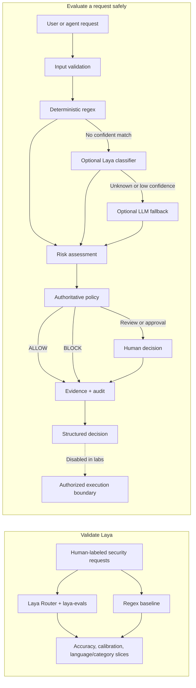

# Laya Decision Labs

Laya Decision Labs is an application-level validation project for [Laya](https://github.com/NandhaKishorM/laya), using security and GRC requests as a decision domain. It measures Laya classifications against labeled examples and a deterministic regex baseline, then separately verifies that risk, policy, approval, evidence, and audit controls behave safely.

It is for both people learning decision concepts and engineers evaluating Laya in an application. This project does not modify Laya's model or claim to validate every language, domain, or capability; the included labeled corpus is a starter set that should be expanded with reviewed holdout examples.

## Architecture



Laya classification is measured independently from policy correctness. Laya and LLM outputs never authorize execution; policy remains deterministic and authoritative.

## Start Here

Requirements: Python 3.10 or newer. PowerShell commands below are for Windows.

```powershell
py -m venv .venv
.\.venv\Scripts\Activate.ps1
python -m pip install -e .
python -m pytest
laya-evals validate research/evals/laya_security_classification.jsonl
python labs\32_laya_validation\main.py --device cpu
python labs\31_interactive_workflow\main.py
```

The Laya validation command downloads a checkpoint on first inference; the device can be changed to `cuda` or `mps` when supported. Dataset validation and the test suite need no checkpoint download. The interactive workflow asks about a proposed operation, shows how the engine classifies and scores it, applies policy, requests human review when needed, checks a sample cloud resource, then records evidence and an audit event. It does not execute infrastructure changes. By default it makes no LLM or live-cloud calls.

Try a production destructive request to see why an advisory `ALLOW` cannot bypass policy. Approve or reject the request in the demo, then mark the sample resource encrypted, unencrypted, or unknown. The request and audit summary show how those choices affect the outcome.

## For Non-Technical Readers

The engine answers different questions in separate steps:

| Step | Question | Example |
| --- | --- | --- |
| Classification | What kind of operation is this? | `terraform destroy` is destructive |
| Risk | What could its impact be? | Production and privilege increase risk |
| Policy | What must happen before proceeding? | Require review or block |
| Approval | Has an authorized person explicitly approved it? | Named reviewer and reason |
| Evidence | What facts were observed? | A cloud volume reports encryption enabled |
| Audit | What happened, and when? | Structured record linked to the decision |

An unknown request is not automatically safe. Laya answers a typed classification question; it does not decide whether the operation is allowed. An AI-style recommendation in the demo is explicitly simulated and advisory; policy remains authoritative. Human approval does not cause the demo to execute anything.

## Interactive Capstone

Run from the repository root:

```powershell
python labs\31_interactive_workflow\main.py
```

The workflow definition is [workflows/interactive-review.yaml](workflows/interactive-review.yaml). The runner supports only a fixed sequence of approved stages; the YAML cannot run arbitrary Python or shell commands. The capstone demonstrates prompt guardrails, deterministic classification and risk, confidence routing, policy, approval, a separate tool-guard signal, cloud control evaluation, evidence, finding creation, audit, and input redaction.

The capstone brings concepts together; it does not replace the individual lessons. Its advisory choice is a simulation, and cloud information is entered as a local sample rather than fetched from a provider. Optional classifier implementations can be injected into the workflow for development; regex still runs first, and neither Laya nor an LLM can authorize an operation.

## Decision Engine Checks

The engine's regression tests cover these representative outcomes:

| Request/context | Expected policy outcome |
| --- | --- |
| List EC2 instances | `ALLOW` |
| Create an EC2 instance | `REQUIRES_REVIEW` |
| Disable MFA | `REQUIRES_SECURITY_REVIEW` |
| Destroy development infrastructure | `REQUIRES_REVIEW` |
| Destroy production infrastructure | `REQUIRES_HUMAN_APPROVAL` |
| Critical-risk production destruction | `BLOCK` |
| Unrecognized request | `REQUIRES_REVIEW` |
| Privileged context | `REQUIRES_HUMAN_APPROVAL` |
| Potential data exposure | `REQUIRES_SECURITY_REVIEW` |
| Model-classified read-only request | `REQUIRES_REVIEW` |

Inputs are validated before classification. Classification order is deterministic regex, optional Laya, then optional LLM fallback. Only known classification labels with confidence at or above `0.80` are accepted from model classifiers; other results remain `UNKNOWN` and require review. A model-derived `READ_ONLY` classification still requires review. These are policy decisions only; the project has no autonomous executor or remediation path.

## Learning Path

| Labs | Topics |
| --- | --- |
| 01-10 | Choice and score decisions, structured results, model advice versus deterministic decisions, routing, prompt/tool guardrails, middleware, and an enterprise-agent example |
| 11-20 | Security decision engine, configurable policy, evidence, audit, approval, GRC controls, findings, framework mapping, and integration |
| 21-30 | AWS discovery, cloud security controls, Terraform and Kubernetes validation, cloud evidence/compliance/findings, drift, multi-cloud, and integration |
| 31 | Interactive capstone connecting the shared decision-to-audit flow |
| 32 | Laya model evaluation against labeled security requests and a regex baseline |

Reusable implementations live in `src/laya_labs`; labs are intentionally small entry points. The capstone combines representative concepts from all phases, while the numbered labs retain their own focused exercises.

## For Developers

Main modules:

| Area | Responsibility |
| --- | --- |
| `engine` | Classification, risk, policy, approval result, and decision contract |
| `policy` | Deterministic policy evaluation and validated YAML rules |
| `approvals` | Explicit named human decisions |
| `evidence` and `audit` | Observations and structured decision history |
| `grc` | Control evaluation, framework mapping, and findings |
| `cloud` | Provider normalization and read-only analysis |
| `workflows` | Interactive runner for the constrained YAML capstone |
| `evaluation` | Adapter to Laya's official evaluation API for domain-specific tests |

Run the full test suite with `python -m pytest`. Security-sensitive changes should test expected, unknown, and high-risk inputs. See [SPECS.md](SPECS.md) for system boundaries and [AGENTS.md](AGENTS.md) for contribution rules.

### Optional Classifier Injection

`SecurityDecisionEngine` accepts a Laya classifier and/or an LLM provider. The default engine makes no model calls; providers are called only when deterministic regex has no confident match. Laya results below the confidence threshold fall through to the LLM provider, and invalid or low-confidence model labels fail closed to `UNKNOWN`.

```python
from laya_labs.engine.security_decision_engine import SecurityDecisionEngine
from laya_labs.engine.laya_engine import LayaEngine
from laya_labs.integrations.llm import MockLLMProvider

engine = SecurityDecisionEngine(
	laya_engine=LayaEngine(),
	llm_provider=MockLLMProvider(),
)
decision = engine.evaluate(
	"adjust the service topology",
	environment="development",
)
print(decision.classification, decision.policy.action)
```

The mock provider is local and makes no network call. A real LLM adapter must implement the same `classify(request)` interface and return a valid classification plus confidence; policy always evaluates the result independently. See [SPECS.md](SPECS.md) for the classification contract and exact policy order.

## Validate Laya

The starter benchmark is [research/evals/laya_security_classification.jsonl](research/evals/laya_security_classification.jsonl): 35 reviewed examples across seven operation classes in English and Spanish. Lab 32 uses Laya's own `laya.evals` metrics and compares Laya's `Router` output with this repository's regex baseline:

```powershell
laya-evals validate research/evals/laya_security_classification.jsonl
python labs\32_laya_validation\main.py --device cpu --output reports\laya-security-validation.json
```

The report includes Laya's choice accuracy and calibration metrics, plus regex accuracy and language/category slices. Treat the starter-set score as a smoke signal, not a product claim: add independently reviewed, representative holdout cases before making quality or safety conclusions. Policy-engine regression tests are separate from model-accuracy evaluation.

## Cloud Demo

Lab 21 is read-only when connected to AWS. It requires the optional SDK and an AWS profile with only the discovery permissions it needs (`ec2:DescribeInstances` and `ec2:DescribeVolumes`):

```powershell
python -m pip install -e ".[aws]"
python labs\21_aws_discovery\main.py --region us-east-1
```

For local emulation, install Floci and have Docker Desktop running. Start Floci and use its fixed localhost endpoint:

```powershell
floci start
python labs\21_aws_discovery\main.py --floci --seed
```

The seed option creates a disposable encrypted sample instance in Floci only if its instance list is empty. Floci mode uses dummy credentials and cannot seed an AWS account. Stop the emulator with `floci stop`. See [Floci EC2 documentation](https://floci.io/floci/services/ec2/) for Docker and emulator requirements.

Never paste cloud credentials into a lab, workflow input, or source file. The AWS lab's default mode uses the standard AWS SDK credential chain; use `--floci` to explicitly select local emulation.
