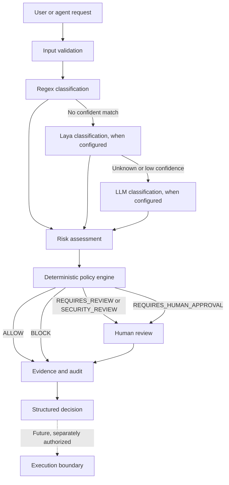

# Laya Decision Labs Specifications

## Purpose and Scope

This repository is an application-level validation project for Laya, using security and GRC requests as a typed-decision domain. It evaluates Laya against reviewed labels and a deterministic regex baseline, then separately tests policy, approval, evidence, and audit controls. It does not reproduce or modify Laya internals, and a small starter corpus is not a general model-quality or security certification. Labs are educational examples, not production automation. The engine may recommend and evaluate; it must not perform autonomous remediation.

## Laya Evaluation Contract

Use the upstream `laya.evals` parser, metrics, and report model. Keep versioned JSONL cases with `state`, `questions`, `expected`, and optional `tags`/`language`. Report Laya choice accuracy and calibration, and compare the same labels with the regex baseline. Slice results by expected class and language. CI may validate dataset shape without loading model weights; model inference is an explicit local evaluation step. Keep model-quality results distinct from policy correctness tests.

## Authoritative Flow



Every path produces a decision record. Labs stop before execution. A human approval recorded by a lab is not permission for the demo to execute infrastructure changes.

## Input Validation

- Request text must be a non-empty string no longer than 2,000 characters.
- Environment must be one of `development`, `staging`, or `production`; accepted values are normalized to lowercase.
- Privilege and data-exposure context must be booleans.
- Never place credentials, secrets, or customer data in workflow inputs. Redact sensitive inline values before audit output.
- Provider responses, workflow YAML, and model outputs are untrusted input and must be validated before use.

## Classification Contract

Classification answers **what kind of operation is requested**, not whether it is authorized. Valid categories are `READ_ONLY`, `MODIFY`, `SECURITY_SENSITIVE`, `DESTRUCTIVE`, `DATA_ACCESS`, `PRIVILEGED`, and `UNKNOWN`.

The classification cascade is deterministic regex first, then optional Laya, then optional LLM when the previous stage is unavailable, unknown, invalid, or below the configured confidence threshold (default `0.80`). Model labels outside the contract and low-confidence results become `UNKNOWN`. Provenance must be canonical (`regex`, `laya`, `llm`, or `none`); a provider cannot claim regex provenance.

Deterministic matches take precedence over model output. Model classification is advisory: a model-derived `READ_ONLY` result requires review and cannot create an automatic `ALLOW`. Classification never produces a policy action.

## Risk Model

Risk estimates potential impact independently from classification. The current deterministic factors are destructive `+0.40`, security-sensitive `+0.25`, modify `+0.10`, production `+0.20`, privileged `+0.10`, and data exposure `+0.20`; cap the sum at `1.0`.

| Score | Level |
| --- | --- |
| `< 0.30` | `LOW` |
| `0.30` to `< 0.60` | `MEDIUM` |
| `0.60` to `< 0.80` | `HIGH` |
| `>= 0.80` | `CRITICAL` |

Risk output includes score, level, and the observed factor names. Tests cover threshold boundaries and combinations of environment, privilege, and data exposure.

## Policy Authority

Policy is deterministic, testable, and authoritative. A model cannot set or override a policy action. Supported outcomes are `ALLOW`, `REQUIRES_REVIEW`, `REQUIRES_SECURITY_REVIEW`, `REQUIRES_HUMAN_APPROVAL`, and `BLOCK`.

Current precedence:

1. `CRITICAL` risk is `BLOCK`.
2. Destructive production work requires human approval; destructive non-production work requires review.
3. Privileged context requires human approval.
4. Potential data exposure requires security review.
5. A model-classified read-only request requires review.
6. Security-sensitive work requires security review; high risk and modifications require review.
7. Only deterministic regex-classified read-only work receives the default `ALLOW`.
8. Unknown, unmatched, invalid, or unavailable decision inputs fail closed to review or block; never default to allow.

YAML policy is versioned and loaded with safe parsing. Validate its version, shape, required fields, and action allow-list. Configuration must not bypass mandatory safety rules.

## Approval Model

Approval is a separate human decision tied to a decision ID and required action. A valid decision records approval ID, named approver, `APPROVED` or `REJECTED` status, timestamp, and non-empty reason. Only pending, registered requests may transition once; unknown, altered, or already-decided requests are rejected. Model output is never human approval. The current implementation is in-memory and is an educational workflow, not a durable approval service.

## Evidence, Audit, and Decision Contract

Evidence represents observed facts, not model explanations. It identifies source, type, resource, collection timestamp, and data. Decision evidence records classification provenance, risk factors, and policy evaluation.

Audit events have a unique event ID, UTC timestamp, event type, decision ID, and structured payload. Sensitive fields and inline credential-like values are redacted. When approval occurs, audit includes approver, status, reason, and timestamp. Audit/evidence stores in this phase are in-memory demonstrations.

Decision results retain the shared contract:

```text
decision_id, request, source, classification, confidence,
risk{score, level, factors}, policy{policy_id, action, reason},
approval{required, status}, evidence[], metadata{}
```

Unknown is a valid result and must not be coerced to an allow.

## Security and Execution Boundaries

- Deterministic controls run before optional model classifiers.
- Fail closed on critical risk, unknown classification, invalid policy, unavailable policy, or missing required approval.
- Approval and execution are distinct. No lab performs autonomous remediation, production mutation, deletion, termination, or security-control changes.
- Tool guards may add restrictions; they cannot grant permission or weaken policy. Actual tool execution requires an independently enforced policy and approval gate.
- Cloud discovery is read-only. Terraform plans and Kubernetes manifests are analyzed, never applied.
- Lab 21 may seed a disposable resource only in explicit Floci mode at `http://localhost:4566`, with dummy credentials; it must never seed a real AWS account.
- Provider SDKs stay optional and outside core dependencies. No secrets in source, prompts, logs, tests, or audit data.

## GRC Readiness

Control models identify framework, control, severity, and evaluation result. Evaluations produce `PASS`, `FAIL`, or `UNKNOWN`; a failed control can create a finding linked to resource and evidence IDs, with severity and remediation recommendation. A finding recommends remediation; the system does not apply it. Framework catalogs and mappings are starter examples, not certifications or complete control libraries.

## Workflow and Phases

The interactive capstone is driven by a versioned YAML definition, but the runner only accepts a fixed allow-listed stage sequence. Workflow files cannot contain executable Python, shell commands, or arbitrary policy expressions. Lab 31 connects representative concepts from Labs 01-30 and complements rather than replaces each focused lesson.

| Phase | Labs | Scope |
| --- | --- | --- |
| 1 | 01-10 | Decisions, classification, guardrails, routing, middleware, and agent patterns |
| 2 | 11-15, 19-20 | Security decision engine, policy, evidence, audit, and approval |
| 3 | 16-18 | Controls, findings, and framework mapping |
| 4 | 21-30 | Read-only cloud discovery, validation, compliance, drift, and integration |
| Capstone | 31 | Interactive cross-phase decision workflow |
| Validation | 32 | Laya domain evaluation against reviewed labels and a regex baseline |
| Future | 33+ | Persistent enterprise services and agentic control plane only by explicit approval |

## Testing Requirements

Run `python -m pytest`. Each security-sensitive change tests the smallest relevant slice, then the full suite. Cover:

- Classification: every valid class, regex precedence, Laya/LLM fallback, invalid labels, confidence threshold, and unknown input.
- Laya quality: validate JSONL without weights, evaluate labeled examples with upstream `laya.evals`, report regex comparison and language/class slices, and label the corpus as a starter benchmark.
- Risk scoring: expected factors, environment/context combinations, and values at/around thresholds.
- Policy evaluation: allow, review, security review, approval, block, model-source restrictions, and fail-closed behavior.
- Decision creation: stable contract, IDs, provenance, metadata, and structured evidence.
- Approval transitions: pending, approve, reject, missing identity/reason, altered request, and duplicate transition.
- Evidence/audit: observed-value linkage, UTC event time, redaction, and policy/approval provenance.
- Security: prompt manipulation, policy override attempts, invalid workflow stages, secrets, and proof no autonomous execution occurs.
- GRC: pass, fail, unknown, finding linkage, and no finding for passing controls.

Cloud labs use fixtures by default. Document prerequisites for any optional live read-only discovery.

## Definition of Done

- Input, classification, risk, policy, approval, evidence, and audit contracts are explicit and typed where practical.
- Unknown and invalid states fail closed; model output cannot authorize or weaken controls.
- Approval provenance is auditable and decisions cannot be replayed or silently changed.
- No autonomous remediation or unintended cloud write path is introduced.
- Positive, negative, boundary, unknown, and security tests pass; full suite passes.
- README, this specification, and workflow configuration agree with implementation.
- Laya accuracy claims cite the dataset, checkpoint/routing mode, and metrics; policy safety claims cite deterministic tests, not model confidence.

## Long-Term Architecture

Keep Laya evaluation, classifier, risk, policy, approval, execution, evidence, audit, and GRC as separate interfaces. Over time, expand the benchmark with independently reviewed held-out domain data, record model revisions and evaluation reports, replace in-memory approval/evidence/audit stores with durable services, version and review policy/control catalogs, and add cloud adapters behind read-only interfaces. Any future agentic executor remains downstream of deterministic policy and explicit human approval for high-impact actions. AI may recommend; policy decides; humans approve; tools execute only after authorization; evidence and audit record what happened.
